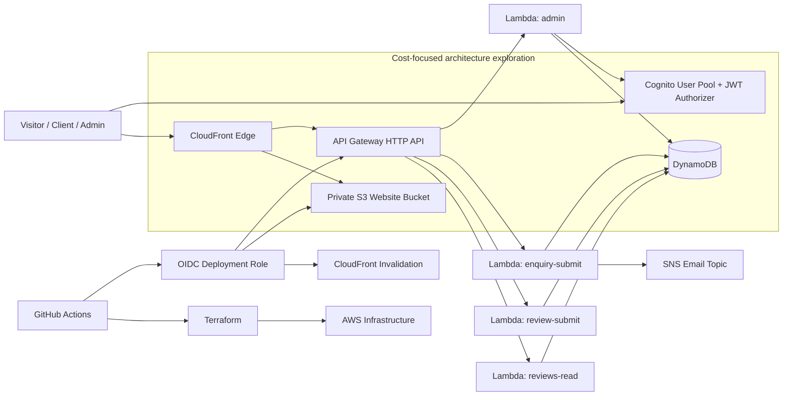
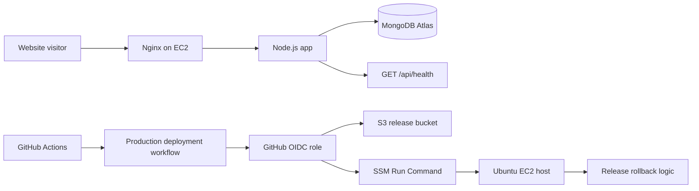

# Golden Plate Catering

**Production status: live.** [Visit Golden Plate Catering](https://goldenplatecatering.duckdns.org/)

## Intro

This project is my first real client project, and it gave me the opportunity to design, build, deploy, and operate a production-aware web application end-to-end. I wanted to show not just frontend work, but also the DevOps thinking behind it: GitHub automation, Infrastructure as Code, secure AWS configuration, deployment safety, and cost-conscious architecture decisions.

The site itself is a real catering business website for a local brand. The engineering value came from combining a polished product with strong operational practices: CI validation, immutable release packaging, controlled AWS access, local health checks, and a measured approach to cost.

I also want to be transparent that the Terraform foundation was not built entirely from scratch: I reused patterns and infrastructure ideas from my earlier Munch_Catering work as a template, then adapted them to this client project, the environment, and the current requirements. That reuse was part of my learning process, and it helped me move quickly while still applying the architecture to a different business context.

I used this project as a practical learning ground for my DevOps journey. It is a blend of product delivery, infrastructure design, and operational discipline, which is exactly the type of work I want to keep building on in my career.

### DevOps stack in focus

- Node.js for the application runtime and API logic
- Terraform for AWS and Atlas configuration
- GitHub Actions for CI, validation, and deployment automation
- AWS SSM, EC2, S3, CloudFront, Lambda, DynamoDB, Cognito, SNS and CloudWatch
- Prometheus, Grafana, Alertmanager and Blackbox for observability
- Secure release + rollback patterns with immutable artifacts and staged activation

## Why I explored a different architecture

One of the key reasons I explored the serverless path was cost efficiency. I wanted to understand whether a CloudFront + S3 + API Gateway + Lambda + DynamoDB model could offer a leaner operating model for a small website while still keeping the product secure and easy to maintain.

This was a design and learning exercise, not a claim that the account already had a confirmed AWS billing advantage. I did not have account-level billing proof available in this environment, so I did not treat the cost reduction as a fact. I treated it as an engineering evaluation: compare the current EC2 + MongoDB Atlas architecture with a serverless option, identify trade-offs, and decide whether the lower-cost path was worth the migration effort before spending money.

That is why the architecture work is framed as a cost-conscious exploration rather than a production migration claim. The live stack remains the verified production baseline until a reviewed bill analysis, a signed-off migration plan, and a fresh Terraform apply are completed.

## Project overview

The site presents the business clearly, lets customers submit enquiries, and separates public content from private moderation flows. The project includes:

- public pages for services, work, menu, reviews, contact and privacy
- image and video assets with accessibility-friendly content
- server-side validation for enquiry and review submissions
- moderated review approval before publication
- secure owner-only admin access for enquiry and review management
- operational metrics and health checks for production reliability

## Architecture diagram



This diagram shows the serverless direction I explored for a cost-aware production model. The goal was to reduce infrastructure overhead while keeping a clean edge layer, a protected admin path, and a low-maintenance deployment model.

## Live production architecture

The current live site is hosted in a more traditional path: an Ubuntu EC2 instance, a Node.js process managed by systemd, MongoDB Atlas for persistence, Nginx for TLS termination, and AWS access managed through SSM and IAM roles. That remains the verified production foundation I used for the site.



This is the baseline architecture I validated first. It is stable, operationally familiar, and appropriate for a real client project while I continued evaluating the lower-cost serverless alternative.

## CI/CD and delivery

I built the project with a practical DevOps mindset:

- GitHub Actions validates every PR and push
- Node checks, build validation and tests are automated
- Terraform is used for AWS and data-layer configuration
- release artifacts are immutable and SHA-based
- deployment is separated from runtime operations
- rollback logic is prepared for the release path

The project also includes the deployment hardening I wrote for safer production operations: host-side activation, version verification, SSM-run release logic, release state tracking, and safe rollback triggers.

## Local development

Requirements: Node.js 22 recommended and npm.

```sh
npm ci
npm run check
npm run build
npm test
npm start
```

Open `http://127.0.0.1:3000`.

## Security and operations notes

- production credentials are never committed to the repository
- runtime secrets are handled through AWS-managed secret and parameter patterns
- the app includes security headers, request validation, rate limiting and admin-only moderation flows
- metrics and monitoring are designed for operational visibility without exposing raw customer data
- no live deployment or unattended production migration is claimed without an approved change and a reviewed plan

## Closing note

This repository reflects the kind of work I want to keep growing in: product engineering, cloud architecture, automation, and operational discipline. It is my first real client project, and it taught me how to move from a working website to something that is easier to trust, safer to deploy, and more professional to operate.

If you are looking for a developer who can think beyond the UI and understand the platform behind the product, this project is a strong example of that mindset.
