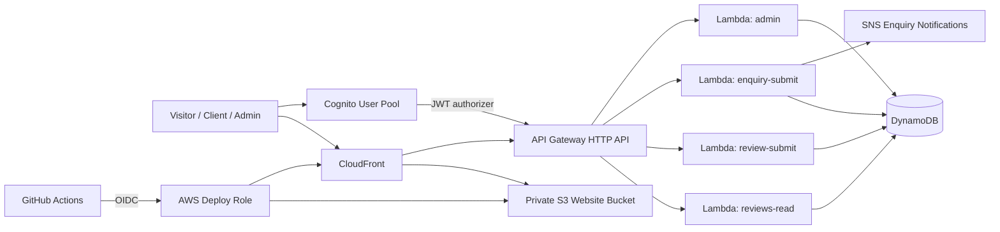

# Golden Plate Catering — Production Website + Serverless Migration

End-to-end design, build, deployment, and operation of a real client's public website — now being migrated from a classic EC2 stack to AWS serverless, with the live site, infrastructure code, CI/CD, observability, and cost controls all owned by one engineer: me.

**Live production site (v1, EC2-backed):** [goldenplatecatering.duckdns.org](https://goldenplatecatering.duckdns.org/) — deployed and operated by me, with ~19 days of Prometheus metrics collected as a measured baseline.

## Highlights

- **Two production architectures designed hands-on:** v1 runs on EC2 + MongoDB Atlas with an immutable release pipeline and rollback; v2 is a serverless stack (CloudFront + private S3, API Gateway HTTP API, Lambda, DynamoDB, Cognito, SNS) defined as an isolated Terraform stack.
- **Deployment safety as a first-class concern:** manual-gated Terraform workflow with plan artifact reuse, an automated plan policy that rejects any non-v2 or destructive change, environment-scoped OIDC roles (no long-lived keys), and pinned-by-digest Trivy scanning after the 2026 Trivy supply-chain incident.
- **Evidence-driven cost analysis:** ~19 days of Prometheus/Grafana metrics from the live v1 host give a measured baseline to compare against serverless — the serverless cost claim will only be published once it can be measured, not asserted.
- **Real application, not a demo:** server-side validation, moderated reviews, enquiry persistence with SNS notifications, health/metrics endpoints, and CloudWatch alarms.

## Overview

Golden Plate Catering is a client-facing catering website with public service and menu pages, review moderation, and enquiry submission. This v2 release represents the serverless architecture direction, using CloudFront and private S3 for the website, API Gateway and Lambda for application APIs, DynamoDB for application data, Cognito for administrator authentication, and SNS for notifications.

The serverless resources are defined as an opt-in Terraform stack. `enable_serverless` defaults to `false`; enabling and applying it is a deliberate production change, not an automatic cutover. The existing EC2 release remains the known production baseline until the v2 deployment and migration have been verified.

## v2 architecture



## Application capabilities

- Public pages for services, menu, work, reviews, contact, and privacy.
- Server-side validation for submitted reviews and enquiries.
- Review moderation with owner-only authorization.
- Enquiry persistence and optional SNS email notifications.
- CloudFront delivery with a private S3 origin, security headers, and API routing.
- Lambda concurrency bounds and CloudWatch alarms for key failure signals.

## Deployment status and prerequisites

Terraform defines the parallel serverless resources in `terraform/serverless.tf`. Before production deployment:

1. Review and set the serverless Terraform inputs in a protected runtime configuration: enable the stack, choose an available S3 bucket name and Cognito domain prefix, set the eventual public site URL, and provide approved notification/alert addresses.
2. Build the Lambda archive with `npm run package:serverless` and verify the intended source and dependencies are included.
3. Establish the serverless GitHub Actions environment and OIDC trust. The Terraform trust policy is scoped to the `serverless-production` GitHub environment; it is separate from the existing EC2 `production` deployment.
4. Review the full Terraform plan for costs, existing-resource changes, state handling, and data-retention behavior. Do not apply a serverless plan that replaces or destroys v1 resources as part of initial provisioning.
5. Deploy the static assets and API, test health and user flows, confirm SNS subscriptions, and migrate/validate any production reviews, enquiries, and administrator accounts before changing public traffic.
6. Perform an approved DNS/domain cutover only after the v2 environment passes acceptance checks. Keep a documented rollback route to v1.

The repository does not currently have a separate serverless deploy workflow, and a successful production cutover is not claimed in this README. The classic `Production deployment` workflow targets the EC2 application and must not be mistaken for a v2 deployment workflow.

## Cost notes

AWS billing data checked on 4 November 2026 showed a $1/month account budget, $0 actual account spend, and a $44.672 account-wide forecast. Cost Explorer showed $0 billed EC2 compute for `eu-west-1` during August–October 2026, while AWS Pricing lists the live v1 Linux `t3.micro` at $0.0114/hour (about $8.32 for 730 hours). These are account-level billed data and a gross EC2 compute list-price component, not a Golden Plate total-cost comparison.

A v2 total-cost forecast and savings percentage are not stated: the serverless stack has not yet been deployed and measured, and comparable request, transfer, storage, and database-migration quantities are not yet established. Cost details and calculation scope are documented in the v1 README alongside its baseline.

## CI and security checks

Pull requests and `main` pushes run application syntax checks, build validation, and tests. CI also runs Trivy scans against the repository filesystem (vulnerability, IaC misconfiguration, and secret checks) and the built container image; CRITICAL/HIGH findings with fixes available fail the pipeline. Container publication waits for successful test/security and image-build jobs.

The scanner image is pinned to an immutable digest and Trivy version 0.69.3, avoiding reliance on mutable scanner tags after the documented 2026 Trivy supply-chain incident. See the [Trivy security advisory](https://github.com/aquasecurity/trivy/security/advisories/GHSA-69fq-xp46-6x23). A local Trivy IaC/secret scan found two existing findings in the v1 Terraform: unrestricted outbound security-group traffic (CRITICAL) and S3 SSE-S3 rather than a customer-managed KMS key (HIGH). These findings were not suppressed; the scan exits nonzero. Resolve them or make a reviewed, documented exception before treating the security gate as passing.

## Development and validation

Requirements: Node.js 22 (Node.js 20 or newer is supported) and npm.

```sh
npm ci
npm run check
npm run build
npm test
npm run package:serverless
```

## Repository layout

- `public/`, `assets/` — website interface and supplied media.
- `lambda/` — serverless API handlers.
- `terraform/` — v1 and optional v2 infrastructure definitions.
- `scripts/` — packaging and deployment tooling.
- `test/` — application and handler tests.
- `monitoring/` — observability stack documentation and configuration.
