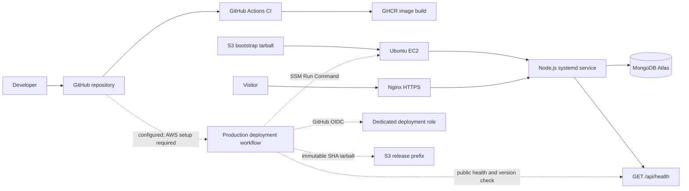

# Golden Plate Catering

**Production status: live.** [Visit Golden Plate Catering](https://goldenplatecatering.duckdns.org/)

## Project Overview

Golden Plate Catering is a real catering business. This repository contains its commissioned public website, built and deployed by me as the engineering owner for the client engagement. The website gives the business a digital place to present its catering work and services and makes it easier for prospective customers to send enquiries.

The project is intended to strengthen the business's online presence and discoverability. Those are objectives, not measured outcomes: no traffic, ranking, conversion or revenue claims are made here.

## Website Capabilities

- Responsive public pages for the business, services, work, menu, reviews, contact and privacy information.
- Supplied event imagery and video, with accessible descriptions.
- Server-validated catering enquiries, persisted server-side and presented in an authenticated owner dashboard.
- Customer reviews submitted for moderation; only approved reviews appear publicly.
- Rate limiting, honeypot checks, security headers and a health endpoint.
- Public business contact and social details remain blank until approved by the client.

## Technology

- Node.js HTTP server (Node.js 20+; CI uses Node.js 22), ES modules and a static HTML/CSS/JavaScript frontend.
- MongoDB Node.js driver. Production persistence is MongoDB Atlas; local development can use ignored JSON files when `MONGODB_URI` is unset.
- AWS EC2 running Ubuntu, Nginx, systemd and SSM Agent. Nginx terminates HTTPS and proxies to the host-managed Node process.
- Terraform manages the AWS deployment resources and MongoDB Atlas configuration.
- GitHub Actions provides CI, a GHCR container build, and a separate tarball-based production deployment workflow.

## Production Architecture

The live application is not running in Docker. The existing production path bootstrapped a tarball from a private S3 bucket onto EC2; the service is managed by `golden-plate.service`, and runtime credentials are retrieved from SSM Parameter Store using the EC2 instance role. The production `/api/health` endpoint and public HTTPS site were checked during this implementation.



The new deployment workflow does not change the live host until its prerequisites are configured and it is run. It packages immutable commit-SHA tarballs, uploads them under a dedicated S3 prefix, invokes a host-side staged release, restarts systemd, checks local and public health/version, and restores the previous release on a failed check. The switch includes a brief systemd restart; zero downtime is not claimed. A manual dispatch can redeploy an existing SHA for rollback.

### CI and Deployment

`.github/workflows/ci.yml` runs checks, build and tests on pull requests and pushes to `main`, and builds/publishes the existing GHCR image. `.github/workflows/deploy.yml` separately verifies and deploys only from `main` through GitHub OIDC, S3 and SSM. Production deployments are serialized and are never triggered by pull requests.

The deployment workflow is implemented but not yet operational: the Terraform role has not been applied, the GitHub production Environment and variables are not configured, and no deployment has been run against the live host. See [Terraform deployment setup](terraform/README.md) for the exact activation steps.

## Local Development

Requirements: Node.js 22 recommended and npm.

```sh
npm ci
npm run check
npm run build
npm test
npm start
```

Open `http://127.0.0.1:3000`. `npm run dev` starts the Node watch mode.

Copy `.env.example` to `.env` for local configuration. `MONGODB_URI` must start with `mongodb://` or `mongodb+srv://`; leave it empty to use local JSON persistence. The server reads `.env` without overriding shell-provided values. Do not use production credentials or data for local testing. The `.env` parser accepts matching single or double quotes around values.

### Docker

Docker remains useful for local container testing and the existing GHCR image workflow; it is not the production deployment runtime.

```sh
docker build -t golden-plate-catering .
docker volume create golden-plate-data
docker run --rm -p 3000:3000 \
	-v golden-plate-data:/data \
	-e ADMIN_USERNAME='local-moderator' \
	-e ADMIN_PASSWORD='use-a-long-random-password' \
	golden-plate-catering
```

The container runs as the unprivileged `node` user and has a health check. Persist `/data` when using local JSON persistence; supply production secrets only through a secret manager.

## Configuration and Data

Public-facing contact, social, story and service values are maintained in `public/site-config.js` and must be approved by the client before publication. Server settings are documented in `.env.example`. The production host loads MongoDB and moderation credentials from SSM Parameter Store; no such values belong in this repository or GitHub variables.

Production enquiry and review records are stored in MongoDB Atlas. Deployment archives exclude `.env`, JSON data, Terraform files/state, local dependencies and generated output. The release installer keeps application releases under `/opt/golden-plate/releases` and configures the JSON fallback directory at `/var/lib/golden-plate/data`, outside the release tree; the current live application uses Atlas. Local JSON files are ignored by Git. Back up MongoDB and protect Terraform state independently.

## Observability

The application now has an authenticated `/metrics` endpoint with bounded route/method/status/environment labels, request latency and aggregate enquiry/review/deployment counters. Metrics are disabled unless `METRICS_TOKEN` is configured. The Prometheus/Grafana/Alertmanager/Node Exporter/Blackbox configuration and five provisioned dashboards are in [`monitoring/`](monitoring/README.md).

The live EC2 instance is a `t3.micro` with about 0.9 GiB RAM and Docker is not installed there. The complete monitoring stack is therefore intentionally not deployed on production. A separate monitoring host, client approval, secure metrics-token provisioning, Slack webhooks and private Node Exporter access remain prerequisites. No monitoring service ports are public.

Google Analytics 4 and Search Console are not currently configured. They should be added only with approved property IDs and privacy settings. Prometheus enquiry counts are aggregate operational metrics, not visitor analytics or confirmed bookings; persisted server-side records remain the source of truth for enquiries.

## Security and Operations

- Public EC2 ingress is limited to HTTP and HTTPS; administration uses SSM rather than SSH.
- EC2 requires IMDSv2 and uses an instance role for S3, SSM and Parameter Store access.
- The deployment role is separate from the runtime role and trusts only this repository's `production` GitHub Environment. Configure that Environment to allow `main` only and require an authorized reviewer.
- Terraform state contains sensitive values. The existing checkout uses local state; secure it and arrange encrypted, access-controlled state storage before future Terraform changes.
- The application has a single-process in-memory rate limiter; horizontal scaling requires shared rate limiting. The current host is a single point of failure.
- No production deployment or monitoring alert delivery has been claimed as tested. See the [observability runbook](monitoring/README.md) for rollout, validation and recovery requirements.

## Client Content

Business story, approved service/menu details, contact channels, social links and final privacy/retention wording require client approval before they are added. No unverified testimonials, prices, addresses, ratings or business performance claims are included.
