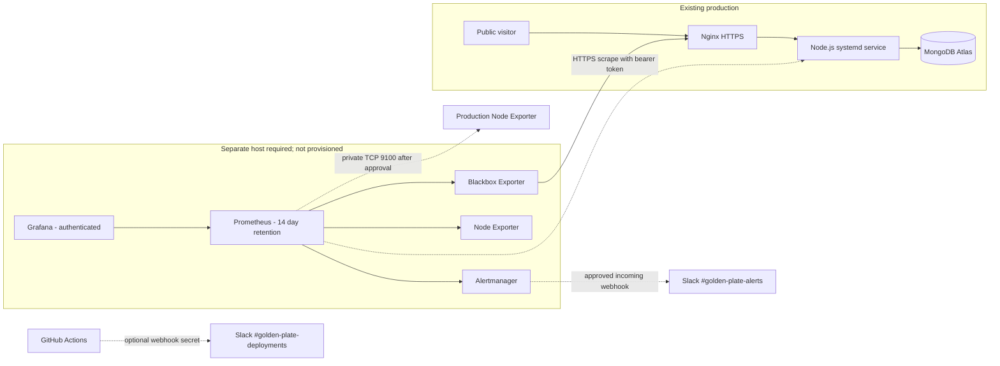

# Observability Operations

## Status and Capacity Decision

The production application was inspected through AWS Systems Manager on 2026-10-31. It runs on an Ubuntu 24.04 `t3.micro` with 1 GiB nominal RAM (about 909 MiB visible), 20 GiB root storage, about 519 MiB available RAM and 16% root filesystem use at inspection time. The observed load averages were 0.08, 0.02 and 0.01. `golden-plate.service`, Nginx and the SSM Agent were active; Docker and Docker Compose were not installed. The security group admits public TCP 80/443 only. Public HTTPS and `/api/health` returned 200 with a valid TLS chain.

Prometheus, Grafana, Alertmanager and two exporters should not be colocated on this host. The Compose stack is prepared for a separate, approved monitoring EC2 host. Nothing in this directory has been deployed to AWS, and no alert, scrape, Slack delivery or reboot-persistence test has been claimed as successful.

## Architecture



Prometheus and exporters have no host-published public ports. Grafana, Prometheus and Alertmanager bind to loopback on the monitoring host and are reached through an SSM port-forwarding session. The production `/metrics` route is protected by a bearer token. Production Node Exporter still requires installation and a security-group rule from the dedicated monitoring security group; the optional Terraform input defaults to `null`.

Release-blocking checks are the SSM host deployment result and public HTTPS `/api/health` response/version. Monitoring target availability is advisory until a separate host is configured; its absence is reported as unconfigured, not treated as application success. Once configured, scrape checks should be added to the release workflow only through a private, authenticated management path, never by publishing Prometheus or exporter ports. A scrape outage does not override an application health failure.

## Components

- Prometheus scrapes every 30 seconds, retains 14 days of data, caps its TSDB at 5 GB, persists to a named Docker volume, and evaluates recording and alert rules.
- Node Exporter collects metrics from the monitoring host. A file-discovery target is reserved for the production EC2 private address after the private rule and host service are approved.
- Blackbox Exporter checks only the public homepage and `/api/health` over HTTPS. It records HTTP success/status/latency, DNS lookup and certificate expiry.
- The application exports bounded HTTP metrics, aggregate enquiry/review counts, version and persisted deployment state. Customer names, contact information, IDs and arbitrary paths are not metric labels.
- Grafana provisions Infrastructure Overview, Application Performance, Availability and Uptime, Deployment and Release Overview, and Business Activity dashboards.
- Alertmanager sends operational firing and recovery notifications to the approved `#golden-plate-alerts` Slack webhook. GitHub Actions uses a separate secret/webhook for `#golden-plate-deployments`.

## Required Approval and AWS Setup

1. Obtain client approval for a separate monitoring host and its recurring charge. A 4 GiB instance is the recommended starting point for the five containers and OS; the live application host is not suitable.
2. Create the monitoring host in the existing production VPC with SSM enabled, an instance role for Systems Manager, a dedicated security group, and no public ingress. Permit outbound HTTPS for image pulls/SSM or use approved VPC endpoints.
3. Install Docker Engine and the Compose plugin on that host. Keep Grafana/Prometheus/Alertmanager ports bound to localhost as configured. Do not add inbound rules for ports 3000, 9090, 9093, 9100 or 9115.
4. Approve an application metrics bearer token. Store the token as a protected file at `/etc/golden-plate/metrics.env` on the application host with mode `0600` and owner `root`; the release systemd drop-in reads that file. Store the matching token in `monitoring/secrets/app_metrics_token` on the monitoring host with owner `root`, group `65534`, mode `0440` so Prometheus's unprivileged container user can read it. Synchronize it through an approved secret-management process, never a workflow command line or repository file.
5. Install the Ubuntu `prometheus-node-exporter` package on the production host only after approval by running `sudo bash monitoring/install-production-node-exporter.sh` through an approved SSM session. The script uses IMDSv2 and binds to the host's private IPv4 address. Set Terraform `monitoring_security_group_id` to the monitoring host's dedicated security group, review the plan, and apply only the TCP 9100 source-security-group rule. Add the production host private address to `monitoring/prometheus/targets/production-host.json` as a JSON list, for example `[{"targets":["<private-address>:9100"]}]`.
6. Request dedicated Slack incoming webhooks for the operational and deployment channels. Put the operational webhook in `monitoring/secrets/slack_alerts_webhook` with owner `root`, group `65534`, mode `0440`; configure GitHub secret `SLACK_DEPLOYMENT_WEBHOOK_URL` for the deployment channel. Never commit either value.
7. Generate a unique Grafana administrator password and place it in `monitoring/secrets/grafana_admin_password` with owner `root`, group `472`, mode `0440` so Grafana's unprivileged process can read it. These three secret files are ignored by Git.

The application metrics route returns 404 unless `METRICS_TOKEN` is configured, so it remains closed by default. The release service reads the optional `/etc/golden-plate/metrics.env`; no production secret has been created or installed by this change.

## Deploy the Monitoring Host

From the `monitoring` directory, after provisioning the host and creating the secret files:

```sh
docker compose config --quiet
docker compose pull
docker compose up -d
docker compose ps
```

The Compose file pins image versions, sets per-container memory/CPU caps, enables restart-after-reboot behavior, and persists Prometheus, Alertmanager and Grafana data in named volumes. Prometheus retention is limited to 14 days/5 GB. Do not increase retention until disk use has been reviewed.

Use SSM port forwarding from an authorized workstation to access Grafana at `http://127.0.0.1:3000`:

```sh
aws ssm start-session \
  --target "$MONITORING_INSTANCE_ID" \
  --document-name AWS-StartPortForwardingSession \
  --parameters '{"portNumber":["3000"],"localPortNumber":["3000"]}' \
  --region "$AWS_REGION"
```

Prometheus and Alertmanager can be accessed with equivalent sessions using remote ports 9090 and 9093. Do not create public ingress to make dashboards convenient.

## Secrets and Environment

| Location | Value | Purpose |
| --- | --- | --- |
| Application host `/etc/golden-plate/metrics.env` | `METRICS_TOKEN=<approved random token>` | Bearer authentication for `GET /metrics`; root-owned, mode 0600 |
| `monitoring/secrets/app_metrics_token` | Same token | Prometheus authenticated scrape; mode 0600 |
| `monitoring/secrets/slack_alerts_webhook` | Operational Slack webhook URL | Alertmanager operational notifications |
| `monitoring/secrets/grafana_admin_password` | Unique administrator password | Grafana bootstrap credential |
| GitHub repository secret `SLACK_DEPLOYMENT_WEBHOOK_URL` | Deployment Slack webhook URL | Workflow started/completed outcome notices |

Do not pass token or webhook values as CLI arguments, Terraform outputs, workflow logs, metric labels, or dashboard variables. Rotate each secret using the same approved process at both endpoints.

## Dashboards and Metric Coverage

- **Infrastructure Overview:** CPU, available memory, filesystem use/free space, network receive/transmit and system load. Production host panels remain empty until its private exporter target is enabled.
- **Application Performance:** request rate, bounded status distribution, 5xx ratio, p50/p95/p99 latency, and aggregate persisted submissions.
- **Availability and Uptime:** blackbox success, response duration/status, DNS resolution duration and TLS days remaining.
- **Deployment and Release Overview:** current application SHA, successful/failed deployment totals, rollback total, last attempt duration and last success timestamp.
- **Business Activity:** persisted enquiries, failed enquiry attempts and persisted reviews. These are aggregate submission events, not visitors, customers or bookings.

Prometheus is operational telemetry, not search analytics. Google Analytics 4 and Google Search Console are not configured. Add them only after the client approves the property IDs, privacy notice and consent requirements; never send enquiry PII to those tools.

## Alerts and Routing

Operational alerts use Alertmanager grouping (`alertname`, `instance`, `severity`), a 30-second group wait, 5-minute group interval, 4-hour repeat interval and recovery notifications. Implemented rules cover public probe failure, app metrics scrape failure, production/monitoring Node Exporter availability, Prometheus self-scrape, sustained CPU >85% for 15 minutes, memory >90% for 10 minutes, root disk >85% for 10 minutes, HTTP 5xx ratio >5% for 10 minutes, p95 latency >1.5 seconds for 10 minutes, and TLS expiry within 14 days.

Alerts depending on production host metrics cannot evaluate until Node Exporter is installed and the private target is configured. Slack routes cannot deliver until the client-approved webhook is supplied. Deployment notifications use GitHub Actions and report the release SHA, environment, run link and rollback outcome; notifications do not claim success unless the workflow succeeds.

## Validation

After the separate host and secrets are configured, validate in this order:

1. `docker compose config --quiet` and `docker compose ps`.
2. `curl http://127.0.0.1:9090/-/healthy` and `curl http://127.0.0.1:9090/api/v1/targets`; confirm Prometheus, exporters and production HTTP probes are `up`.
3. Query `probe_success`, `probe_http_status_code`, `probe_dns_lookup_time_seconds`, and `probe_ssl_earliest_cert_expiry` in Prometheus.
4. Confirm the authenticated `production-app` target is up and query `application_info`, `http_requests_total`, `enquiries_submitted_total` and `deployment_successes_total`.
5. Confirm Grafana provisions all five dashboards and its Prometheus data source is healthy.
6. Run `promtool check config` and `promtool check rules` using the pinned Prometheus image; run `amtool check-config` using the pinned Alertmanager image.
7. Send an approved synthetic test alert to a non-customer test route or approved Slack channel and verify both firing and resolved notifications. Do not trigger resource or availability alerts by disrupting production.
8. Restart containers and verify volume-backed history persists. Schedule a controlled monitoring-host reboot and verify restart policies. Do not reboot the production application host as an alert test.

None of these remote integration tests have been run because the monitoring host, token and Slack destinations have not been provisioned.

## Maintenance, Backup and Troubleshooting

- Back up `monitoring/` configuration in Git and back up the `prometheus-data`, `grafana-data` and `alertmanager-data` volumes before host replacement or maintenance. Keep backups encrypted and access-controlled; metrics can reveal operational and business activity.
- For a consistent manual volume backup, stop stateful services, archive each named volume to an encrypted backup directory, then restart services:

  ```sh
  backup_dir=/path/to/encrypted-backups
  docker compose stop prometheus alertmanager grafana
  for volume in prometheus-data alertmanager-data grafana-data; do
    docker run --rm \
      --mount "type=volume,source=golden-plate-monitoring_${volume},target=/source,readonly" \
      --mount "type=bind,source=$backup_dir,target=/backup" \
      alpine:3.22 tar -czf "/backup/${volume}-$(date -u +%Y%m%dT%H%M%SZ).tar.gz" -C /source .
  done
  docker compose start prometheus alertmanager grafana
  ```
- Inspect `docker compose logs --since=30m prometheus alertmanager grafana node-exporter blackbox-exporter` for component failures. Do not paste secret files or webhook-bearing configuration into tickets.
- If a target is down, verify the host service, private route/security-group source, target address and Prometheus target status. For app metrics, check file permissions and that the token matches without printing it.
- If notifications stop, verify Alertmanager's active alerts, webhook rotation and approved channel. Test with a synthetic alert; do not lower real alert thresholds just to generate a message.
- For disk pressure, inspect Prometheus volume size and retention before deleting data. Prometheus history is disposable only if stakeholders accept losing it; dashboards and configuration remain in Git.
- For application rollback, use the authorized GitHub manual deployment with a known existing 40-character release SHA. The host retains prior releases under `/opt/golden-plate/releases`; MongoDB and `/var/lib/golden-plate/data` are outside the release directories.
- On a failed deployment, inspect the SSM command invocation and systemd journal. The workflow fails when host or public health/version verification fails; public verification failure triggers an independent SSM rollback request.

## Resource and Cost Estimate

The existing application EC2 remains unchanged and receives no monitoring containers. The Compose caps total roughly 1.3 GiB of container memory before the host OS, so a separate 4 GiB instance is the recommended starting point; provision a 30 GiB gp3 volume and monitor actual usage. A planning-only estimate for one continuously running `t3.medium`, 30 GiB gp3 and one public IPv4 address in the Ireland region is approximately **US$35–45 per month**, before data transfer, taxes, support or price changes. This is not a live AWS quote; use the AWS Pricing Calculator and client approval before creating resources. No monitoring infrastructure cost was created by this change.